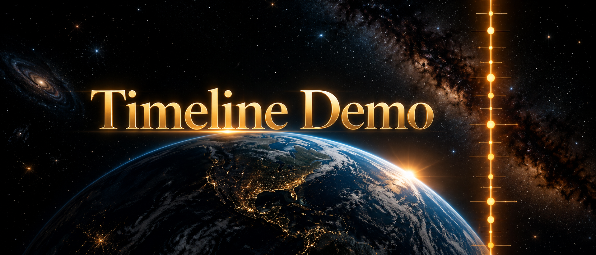
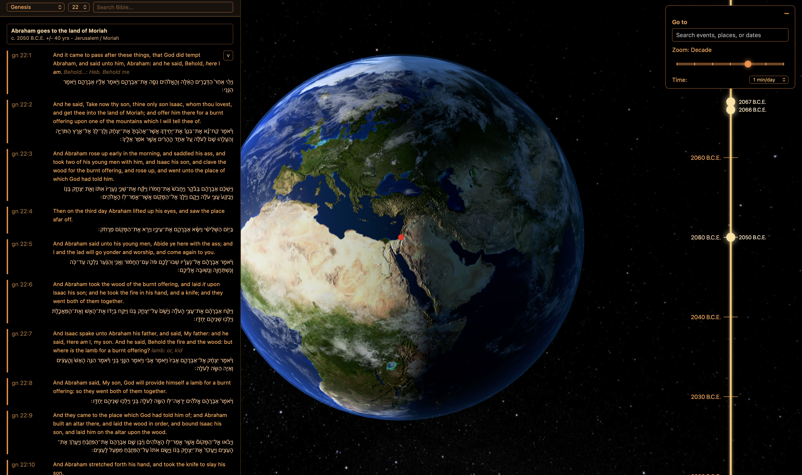

# TimelineDemo

Renders a vertical biblical timeline beside a Three.js earth, sun, moon, and starfield scene.

The long-term goal is a searchable biblical archive through time and space: selecting a passage or
event should move the timeline to the approximate date and rotate the globe toward the approximate
place.

## Live Application Screenshot



## Current Astronomy Model

The space scene is a visual reconstruction layer, not a full observatory-grade ephemeris. It is
designed to stay performant while giving biblical and historical events plausible celestial context.

- The sun position is deterministic from the current timeline date and simulates day/night without
  continuously rotating the earth relative to the viewer.
- The visible starfield follows the earth orientation and uses only a small seasonal wobble. This
  preserves a sense of time passing without making the background visibly loop on a yearly cycle.
- The moon uses a compact Meeus-style geocentric lunar position calculation derived from periodic
  terms for lunar longitude, latitude, and distance.
- The scene uses Earth-radius units for celestial movement: Earth radius is `1`, the Moon's rendered
  radius is about `0.273`, the Moon's center distance comes from calculated Earth-Moon distance in
  kilometers, and the Sun is placed about one astronomical unit away with its proportional radius.
  With the current close Earth camera, the Moon and Sun are therefore often out of frame or small by
  design.
- The moon's north/south position comes from calculated lunar ecliptic latitude, which is important
  for eclipse alignment.
- Solar eclipse shadows are represented with a cheap visual approximation: one transparent radial
  texture on a small plane near Earth's surface when the sun and moon align closely.
- The cloud layer uses a cosmetic drift model. Its baseline assumes about 8 mph cloud movement,
  scaled through the Time control rather than attempting to simulate weather systems.
- NASA solar eclipse reference data is stored separately under `src/app/data/astronomy/`. This data
  should be used as a ground-truth fixture for validating future eclipse-path calculations before
  replacing the current visual approximation.

### Accuracy Notes

The lunar calculation is intended to make phases, distance changes, and node crossings line up
reasonably well with real dates. For ancient BCE dates, exact eclipse visibility still needs explicit
event metadata and historical eclipse catalog validation because calendar conversions and long-term
Earth rotation uncertainty matter.

Future event metadata should distinguish between:

- ordinary astronomical events, such as solar eclipses, lunar eclipses, moon phases, and local solar
  time;
- textual sign or miracle events, such as the shadow moving backward in 2 Kings 20 and Isaiah 38.

### NASA Eclipse References

The first imported reference is NASA's Total Solar Eclipse of 2027 Aug 02. It includes:

- greatest-eclipse location and timing;
- sampled central-line path coordinates;
- Besselian polynomial coefficients;
- source URLs for NASA's path table and Besselian elements table.

This reference intentionally confirms that the total path is near North Africa, Egypt, the Red Sea
region, Yemen, Somalia, and the Indian Ocean. Israel is outside the totality path but within the
broader partial-visibility region.

This project was generated using [Angular CLI](https://github.com/angular/angular-cli) version 20.3.4.

## Development server

To start a local development server, run:

```bash
nvm use 22
ng serve
```

Once the server is running, open your browser and navigate to `http://localhost:4200/`. The application will automatically reload whenever you modify any of the source files.

## Code scaffolding

Angular CLI includes powerful code scaffolding tools. To generate a new component, run:

```bash
ng generate component component-name
```

For a complete list of available schematics (such as `components`, `directives`, or `pipes`), run:

```bash
ng generate --help
```

## Building

To build the project run:

```bash
ng build
```

This will compile your project and store the build artifacts in the `dist/` directory. By default, the production build optimizes your application for performance and speed.

## Running unit tests

To execute unit tests with the [Karma](https://karma-runner.github.io) test runner, use the following command:

```bash
ng test
```

## Running end-to-end tests

For end-to-end (e2e) testing, run:

```bash
ng e2e
```

Angular CLI does not come with an end-to-end testing framework by default. You can choose one that suits your needs.

## Additional Resources

For more information on using the Angular CLI, including detailed command references, visit the [Angular CLI Overview and Command Reference](https://angular.dev/tools/cli) page.
